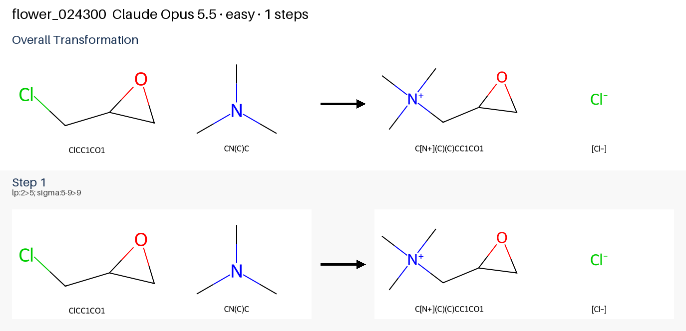
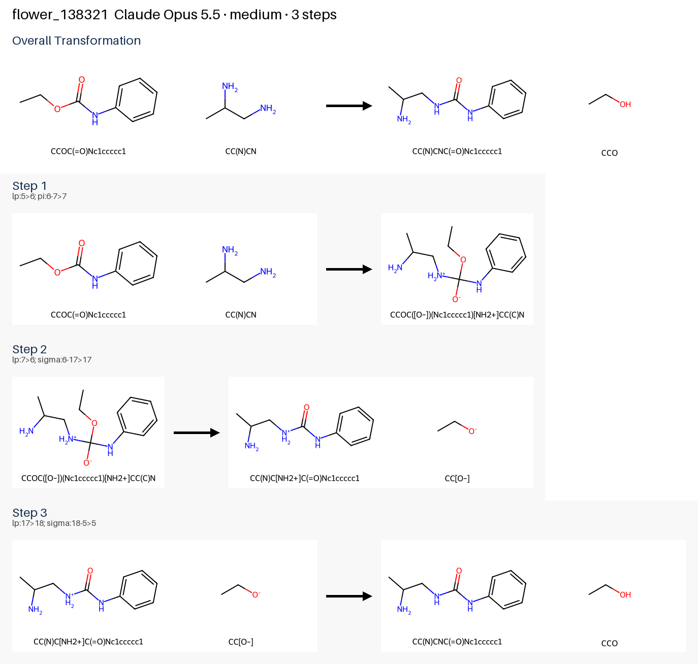
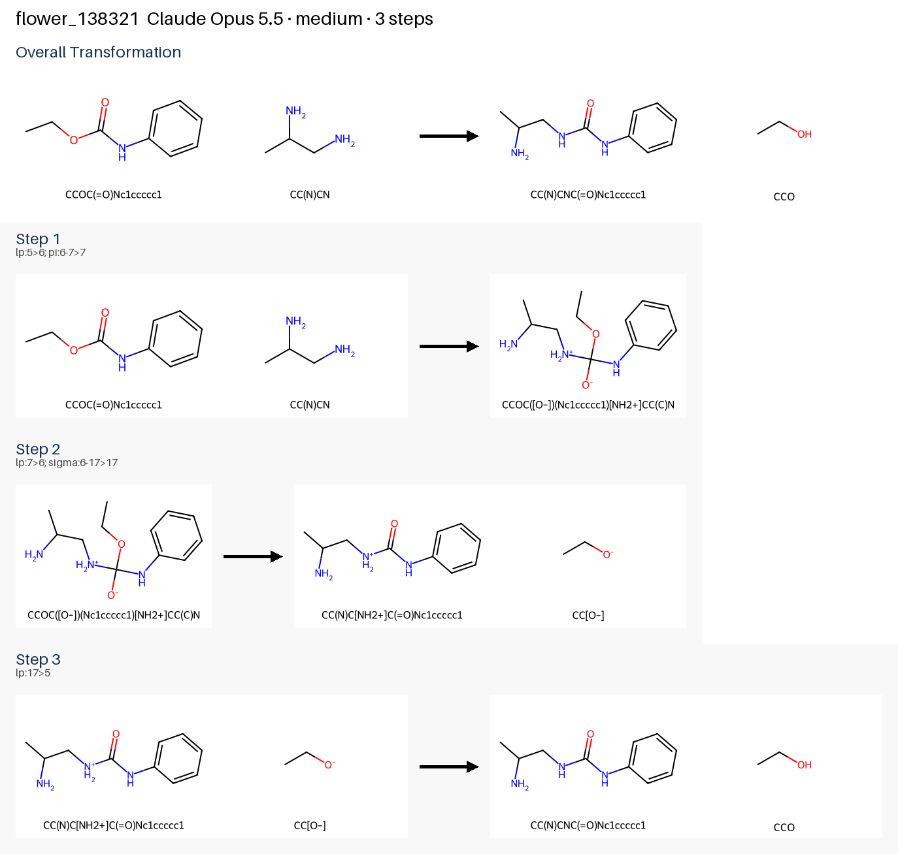
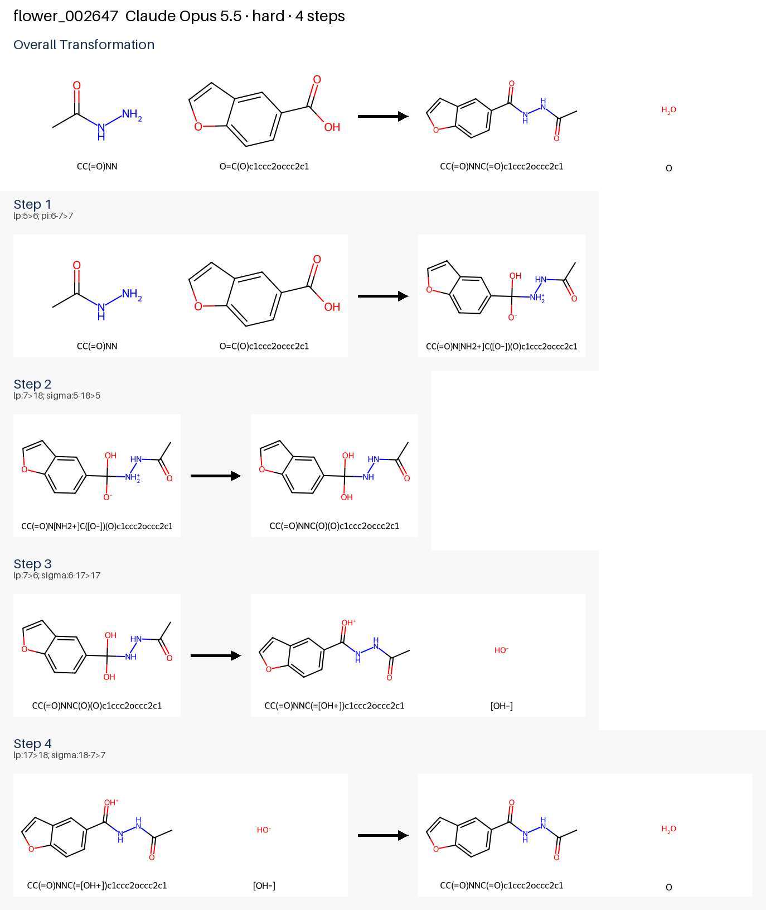
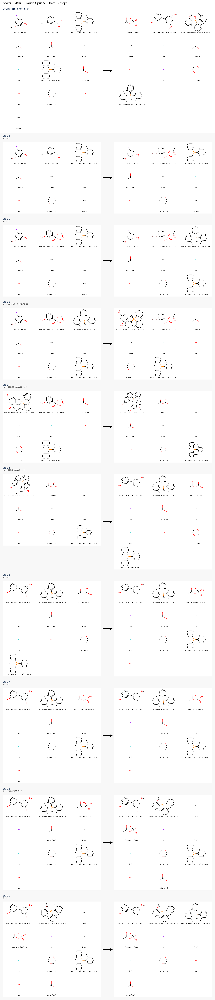
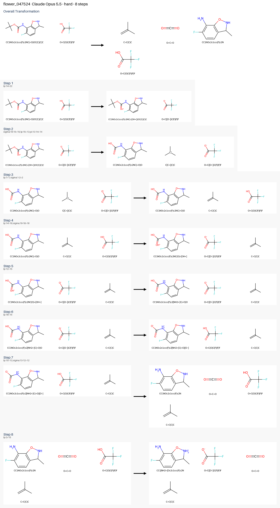
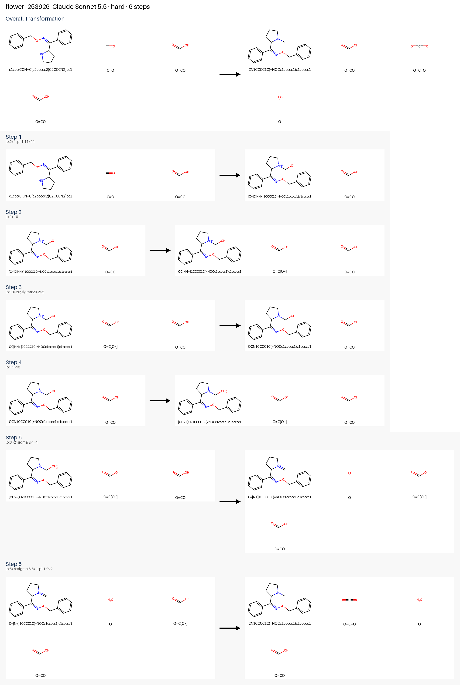
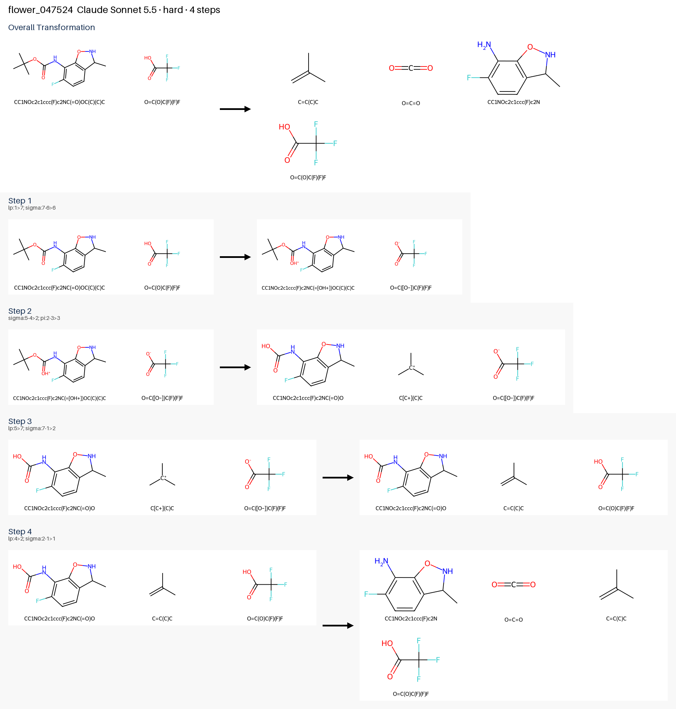
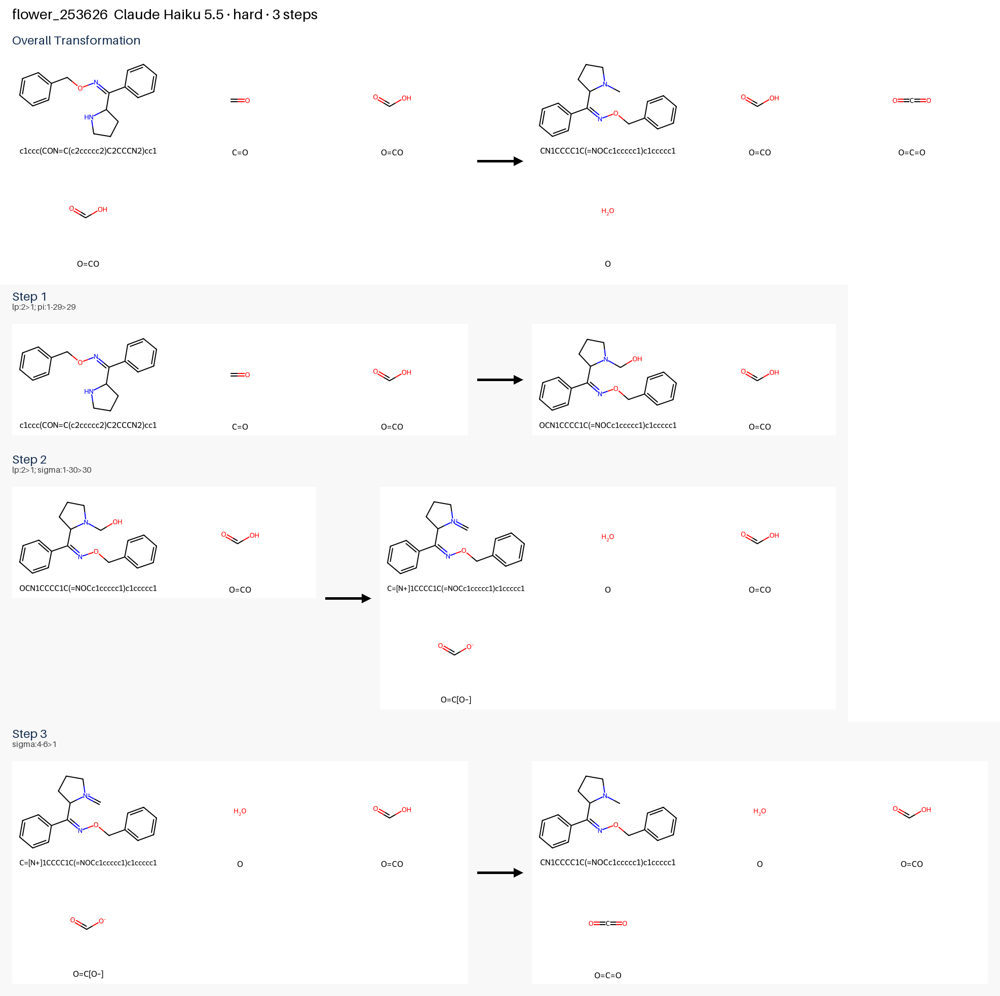
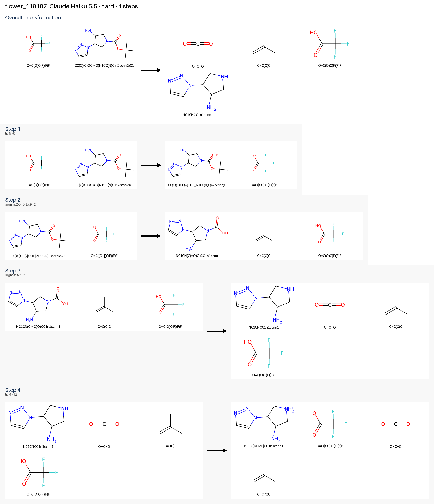

# Leaderboard

Blind mechanism prediction on FlowER-derived development tiers (easy = 1–2 steps, medium = 3, hard = 4–10), 10 cases per tier.

Every mechanism, harness or harness-free baseline, is scored by the same `quality_v2` rubric (`mechanistic_agent/quality_v2.py`, [docs/scoring_quality_v2.md](docs/scoring_quality_v2.md)). Each step is re-checked with the same deterministic code whatever produced it, and every measure is one axis from 0 to 1:

| Axis | Measures |
|---|---|
| Product correct | all targets reached (product given) or the main product in any protonation state (product hidden) |
| Step connectivity | each step starts where the path left off: no intermediate vanishes, no product or intermediate appears from nowhere (small species and solvents ignored) |
| Balanced, progressing | per step: atom and charge balance, and the state changes |
| Arrows + SMIRKS | per step: arrows parse into a bond/electron change and the SMIRKS matches the stated species |
| Electron conservation | per step: the mapped SMIRKS conserves electrons in the bond-electron matrix |
| Matches reference | heavy-atom events in the FlowER reference order (proton-shuttle agnostic) |

**Score** = 1000 × (0.2 · product + 0.3 · connectivity + 0.5 · step quality), where step quality is the mean of the four step axes over the steps the mechanism made. Stopping early costs the product, not step quality; reaching the product through disconnected steps costs more than the product earns. A mechanism with no step (a **failed start**) scores 0 on every axis. **Area** is the radar polygon area (1 = perfect on every axis). A case passes when it also passes `quality_v1` (product, every step valid, mass and charge close, no repeated state), every step is connected, and it scores at least 700.

Generated by `python main.py publish-results` from the records in [`results/runs/`](results/runs/). Do not edit by hand.

## Best model by tier

| Tier | Best model | Thinking | Quality | Valid steps | Passed | Harness | Date | Details |
|---|---|---|---|---|---|---|---|---|
| easy | **Claude Opus 5.5** † | default | **983**/1000 | 86% | 8/10 | `jev_reaction_type` | 2026-09-30 | [results](#2026-09-30-bridge-opus55-jev-deferred-easy-final3) |
| medium | **Claude Opus 5.5** † | default | **1000**/1000 | 100% | 10/10 | `jev_reaction_type` | 2026-09-30 | [results](#2026-09-30-bridge-opus55-jev-deferred-medium-final2-resumed) |
| hard | **Claude Opus 5.5** † | default | **972**/1000 | 96% | 8/10 | `jev_reaction_type` | 2026-09-29 | [results](#2026-09-29-bridge-opus55-jev-hard) |

## Harness vs harness-free baseline

Paired runs (same cases, model and thinking level):

| Cases | Product | Thinking | Model | Radar | One-shot baseline | Harness | Score Δ |
|---|---|---|---|---|---|---|---|
| 10 hard (trial_quality_v1_hard10) | given | low | **Claude Opus 5.5** † |  | **934** area 0.85 failed starts 0% product 10/10, pass 6/10 | **965** area 0.93 failed starts 0% product 9/10, pass 7/10 | +31 |
| 10 hard (trial_quality_v1_hard10) | given | low | **Claude Sonnet 5.5** † |  | **761** area 0.51 failed starts 0% product 9/10, pass 1/10 | **932** area 0.86 failed starts 0% product 8/10, pass 5/10 | +171 |
| 10 hard (trial_quality_v1_hard10) | given | low | **Claude Haiku 5.5** † |  | **777** area 0.53 failed starts 0% product 8/10, pass 1/10 | **726** area 0.51 failed starts 20% product 7/10, pass 3/10 | -51 |
| 10 hard (trial_quality_v1_hard10) | hidden | low | **Claude Opus 5.5** † |  | **900** area 0.79 failed starts 0% product 9/10, pass 2/10 | **938** area 0.88 failed starts 0% product 8/10, pass 4/10 | +38 |
| 10 hard (trial_quality_v1_hard10) | hidden | low | **Claude Sonnet 5.5** † |  | **761** area 0.52 failed starts 0% product 8/10, pass 1/10 | **859** area 0.73 failed starts 10% product 8/10, pass 4/10 | +98 |
| 10 hard (trial_quality_v1_hard10) | hidden | low | **Claude Haiku 5.5** † |  | **720** area 0.45 failed starts 0% product 9/10, pass 0/10 | **649** area 0.41 failed starts 20% product 4/10, pass 2/10 | -71 |

Same cases, same model, same thinking level. Radar: one-shot baseline orange, harness blue, on the six `quality_v2` axes. **Score** is on 1000 (0.2 product + 0.3 step connectivity + 0.5 mean step quality); **area** is the radar polygon area (1 = perfect); **failed starts** is the share of cases where the mechanism made no step. With the product **hidden** the model also had to predict it.

All `quality_v2` runs:

| Tier | Model | Mode | Thinking | Cases | Score | Area | Failed starts | Product correct | Step connectivity | Balanced, progressing | Arrows + SMIRKS | Electron conservation | Matches reference | Passed | Date | Record |
|---|---|---|---|---|---|---|---|---|---|---|---|---|---|---|---|---|
| easy | **Claude Opus 5.5** † | harness `jev_reaction_type` | default | 10 | **983** | 0.96 | 0% | 1.00 | 1.00 | 0.93 | 0.93 | 1.00 | 1.00 | 8/10 | 2026-09-29 | [json](results/runs/2026-09-29_bridge_opus55_jev_easy_r2.json) |
| easy | **Claude Opus 5.5** | harness `default` | default | 10 | **983** | 0.96 | 0% | 1.00 | 1.00 | 0.93 | 0.93 | 1.00 | 1.00 | 8/10 | 2026-09-29 | [json](results/runs/2026-09-29_cli_eval_opus55_easy.json) |
| easy | **Claude Opus 5.5** † | harness `jev_reaction_type` | default | 10 | **983** | 0.96 | 0% | 1.00 | 1.00 | 0.93 | 0.93 | 1.00 | 1.00 | 8/10 | 2026-09-30 | [json](results/runs/2026-09-30_bridge_opus55_jev_deferred_easy_final3.json) |
| medium | **Claude Opus 5.5** † | harness `jev_reaction_type` | default | 10 | **1000** | 1.00 | 0% | 1.00 | 1.00 | 1.00 | 1.00 | 1.00 | 1.00 | 10/10 | 2026-09-29 | [json](results/runs/2026-09-29_bridge_opus55_jev_medium.json) |
| medium | **Claude Opus 5.5** † | harness `jev_reaction_type` | default | 10 | **1000** | 1.00 | 0% | 1.00 | 1.00 | 1.00 | 1.00 | 1.00 | 1.00 | 10/10 | 2026-09-30 | [json](results/runs/2026-09-30_bridge_opus55_jev_deferred_medium_final2_resumed.json) |
| hard | **Claude Opus 5.5** † | harness `jev_reaction_type` | default | 10 | **972** | 0.93 | 0% | 1.00 | 1.00 | 0.98 | 0.96 | 1.00 | 0.83 | 8/10 | 2026-09-29 | [json](results/runs/2026-09-29_bridge_opus55_jev_hard.json) |
| hard | **Claude Opus 5.5** † | harness `jev_reaction_type` | low | 10 | **965** | 0.93 | 0% | 0.90 | 1.00 | 0.97 | 1.00 | 1.00 | 0.91 | 7/10 | 2026-10-05 | [json](results/runs/2026-10-05_trial_q5_harness_low_given_resumed.json) |
| hard | **Claude Opus 5.5** † | harness `jev_reaction_type` · no product | low | 10 | **938** | 0.88 | 0% | 0.80 | 1.00 | 0.97 | 1.00 | 1.00 | 0.85 | 4/10 | 2026-10-05 | [json](results/runs/2026-10-05_trial_q5_harness_low_noprod_resumed.json) |
| hard | **Claude Opus 5.5** † | baseline | low | 10 | **934** | 0.85 | 0% | 1.00 | 0.96 | 1.00 | 0.85 | 0.91 | 0.80 | 6/10 | 2026-10-05 | [json](results/runs/2026-10-05_harness_free_baseline_claude-opus-5-5_81593488.json) |
| hard | **Claude Sonnet 5.5** † | harness `jev_reaction_type` | low | 10 | **932** | 0.86 | 0% | 0.80 | 1.00 | 0.95 | 1.00 | 0.98 | 0.84 | 5/10 | 2026-10-10 | [json](results/runs/2026-10-10_sonnet55_harn_given.json) |
| hard | **Claude Opus 5.5** † | baseline · no product | low | 10 | **900** | 0.79 | 0% | 0.90 | 0.94 | 0.91 | 0.96 | 0.87 | 0.76 | 2/10 | 2026-10-05 | [json](results/runs/2026-10-05_harness_free_baseline_no_product_claude-opus-5-5_064f00ba.json) |
| hard | **Claude Sonnet 5.5** † | harness `jev_reaction_type` · no product | low | 10 | **859** | 0.73 | 10% | 0.80 | 0.90 | 0.87 | 0.90 | 0.90 | 0.76 | 4/10 | 2026-10-10 | [json](results/runs/2026-10-10_sonnet55_harn_hidden.json) |
| hard | **Claude Haiku 5.5** † | baseline | low | 10 | **777** | 0.53 | 0% | 0.80 | 1.00 | 0.78 | 0.51 | 0.45 | 0.79 | 1/10 | 2026-10-10 | [json](results/runs/2026-10-10_harness_free_baseline_claude-haiku-5-5_0aaf1ede.json) |
| hard | **Claude Sonnet 5.5** † | baseline | low | 10 | **761** | 0.51 | 0% | 0.90 | 1.00 | 1.00 | 0.10 | 0.33 | 0.81 | 1/10 | 2026-10-10 | [json](results/runs/2026-10-10_harness_free_baseline_claude-sonnet-5-5_56a80975.json) |
| hard | **Claude Sonnet 5.5** † | baseline · no product | low | 10 | **761** | 0.52 | 0% | 0.80 | 0.98 | 0.99 | 0.30 | 0.35 | 0.82 | 1/10 | 2026-10-10 | [json](results/runs/2026-10-10_harness_free_baseline_no_product_claude-sonnet-5-5_bdb3b3d0.json) |
| hard | **Claude Haiku 5.5** † | harness `jev_reaction_type` | low | 10 | **726** | 0.51 | 20% | 0.70 | 0.80 | 0.68 | 0.77 | 0.67 | 0.66 | 3/10 | 2026-10-11 | [json](results/runs/2026-10-11_haiku55_jev_hard10_given_flower_020948_resumed.json) |
| hard | **Claude Haiku 5.5** † | baseline · no product | low | 10 | **720** | 0.45 | 0% | 0.90 | 1.00 | 0.86 | 0.19 | 0.16 | 0.71 | 0/10 | 2026-10-10 | [json](results/runs/2026-10-10_harness_free_baseline_no_product_claude-haiku-5-5_67177b2e.json) |
| hard | **Claude Haiku 5.5** † | harness `jev_reaction_type` · no product | low | 10 | **649** | 0.41 | 20% | 0.40 | 0.80 | 0.74 | 0.69 | 0.64 | 0.56 | 2/10 | 2026-10-11 | [json](results/runs/2026-10-11_haiku55_jev_hard10_hidden_flower_020948_resumed.json) |

Baselines make one full-mechanism call with no harness. Their steps are scored exactly like harness steps, so an unbalanced, unparseable or disconnected step costs the same. `quality_v1` points stay in each record (`quality_v1`) for reference.

† Answered through the [agent bridge](docs/agent_bridge.md): each model call went to the declared model in a fresh session that saw only the prompt (`responder_saw_ground_truth: false`). Cost is opaque, so these rows make no cost claim.

## Published runs

### easy · **Claude Opus 5.5** † · 2026-09-29

- **983/1000** (area 0.96, failed starts 0%) — product correct 1.00, step connectivity 1.00, balanced, progressing 0.93, arrows + smirks 0.93, electron conservation 1.00, matches reference 1.00
- Targets reached 10/10, passed 8/10, fully connected 10/10, `quality_v1` 976, valid steps 86%, thinking `default`
- Model id `agent-bridge`, harness `jev_reaction_type`, run group `bridge_opus55_jev_easy_r2`, eval run `ec4439ff14404613b31c2419b4af72d1`, commit `c8eb689` — [record](results/runs/2026-09-29_bridge_opus55_jev_easy_r2.json)

| Case | Known steps | Accepted steps | Valid steps | Connected | Target | Passed | Score |
|---|---|---|---|---|---|---|---|
| `flower_024300` | 1 | 1 | 1/1 | 1/1 | ✓ | ✓ | 1000 |
| `flower_054599` | 1 | 1 | 1/1 | 1/1 | ✓ | ✓ | 1000 |
| `flower_085506` | 1 | 1 | 1/1 | 1/1 | ✓ | ✓ | 1000 |
| `flower_086646` | 1 | 1 | 1/1 | 1/1 | ✓ | ✓ | 1000 |
| `flower_130926` | 1 | 1 | 1/1 | 1/1 | ✓ | ✓ | 1000 |
| `flower_135501` | 1 | 3 | 2/3 | 3/3 | ✓ | ✗ | 917 |
| `flower_160718` | 1 | 3 | 2/3 | 3/3 | ✓ | ✗ | 917 |
| `flower_170958` | 1 | 1 | 1/1 | 1/1 | ✓ | ✓ | 1000 |
| `flower_188703` | 1 | 1 | 1/1 | 1/1 | ✓ | ✓ | 1000 |
| `flower_252433` | 1 | 1 | 1/1 | 1/1 | ✓ | ✓ | 1000 |

Hardest mechanism solved: `flower_024300` — reference 1 steps, predicted 1 steps

### easy · **Claude Opus 5.5** · 2026-09-29

- **983/1000** (area 0.96, failed starts 0%) — product correct 1.00, step connectivity 1.00, balanced, progressing 0.93, arrows + smirks 0.93, electron conservation 1.00, matches reference 1.00
- Targets reached 10/10, passed 8/10, fully connected 10/10, `quality_v1` 976, valid steps 86%, thinking `default`
- Model id `anthropic/claude-opus-5.5`, harness `default`, run group `cli_eval_opus55_easy`, eval run `d7b83c6963da4e2a9405f333d3f05b0d`, commit `c8eb689` — [record](results/runs/2026-09-29_cli_eval_opus55_easy.json)

| Case | Known steps | Accepted steps | Valid steps | Connected | Target | Passed | Score |
|---|---|---|---|---|---|---|---|
| `flower_024300` | 1 | 1 | 1/1 | 1/1 | ✓ | ✓ | 1000 |
| `flower_054599` | 1 | 1 | 1/1 | 1/1 | ✓ | ✓ | 1000 |
| `flower_085506` | 1 | 1 | 1/1 | 1/1 | ✓ | ✓ | 1000 |
| `flower_086646` | 1 | 1 | 1/1 | 1/1 | ✓ | ✓ | 1000 |
| `flower_130926` | 1 | 1 | 1/1 | 1/1 | ✓ | ✓ | 1000 |
| `flower_135501` | 1 | 3 | 2/3 | 3/3 | ✓ | ✗ | 917 |
| `flower_160718` | 1 | 3 | 2/3 | 3/3 | ✓ | ✗ | 917 |
| `flower_170958` | 1 | 1 | 1/1 | 1/1 | ✓ | ✓ | 1000 |
| `flower_188703` | 1 | 1 | 1/1 | 1/1 | ✓ | ✓ | 1000 |
| `flower_252433` | 1 | 1 | 1/1 | 1/1 | ✓ | ✓ | 1000 |

Hardest mechanism solved: `flower_024300` — reference 1 steps, predicted 1 steps

### easy · **Claude Opus 5.5** † · 2026-09-30

- **983/1000** (area 0.96, failed starts 0%) — product correct 1.00, step connectivity 1.00, balanced, progressing 0.93, arrows + smirks 0.93, electron conservation 1.00, matches reference 1.00
- Targets reached 10/10, passed 8/10, fully connected 10/10, `quality_v1` 976, valid steps 86%, thinking `default`
- Model id `agent-bridge`, harness `jev_reaction_type`, run group `bridge_opus55_jev_deferred_easy_final3`, eval run `a0ccd2c4e1034662b738c8b2cc29e124`, commit `c8eb689` — [record](results/runs/2026-09-30_bridge_opus55_jev_deferred_easy_final3.json)

| Case | Known steps | Accepted steps | Valid steps | Connected | Target | Passed | Score |
|---|---|---|---|---|---|---|---|
| `flower_024300` | 1 | 1 | 1/1 | 1/1 | ✓ | ✓ | 1000 |
| `flower_054599` | 1 | 1 | 1/1 | 1/1 | ✓ | ✓ | 1000 |
| `flower_085506` | 1 | 1 | 1/1 | 1/1 | ✓ | ✓ | 1000 |
| `flower_086646` | 1 | 1 | 1/1 | 1/1 | ✓ | ✓ | 1000 |
| `flower_130926` | 1 | 1 | 1/1 | 1/1 | ✓ | ✓ | 1000 |
| `flower_135501` | 1 | 3 | 2/3 | 3/3 | ✓ | ✗ | 917 |
| `flower_160718` | 1 | 3 | 2/3 | 3/3 | ✓ | ✗ | 917 |
| `flower_170958` | 1 | 1 | 1/1 | 1/1 | ✓ | ✓ | 1000 |
| `flower_188703` | 1 | 1 | 1/1 | 1/1 | ✓ | ✓ | 1000 |
| `flower_252433` | 1 | 1 | 1/1 | 1/1 | ✓ | ✓ | 1000 |

Hardest mechanism solved: `flower_024300` — reference 1 steps, predicted 1 steps

### medium · **Claude Opus 5.5** † · 2026-09-29

- **1000/1000** (area 1.00, failed starts 0%) — product correct 1.00, step connectivity 1.00, balanced, progressing 1.00, arrows + smirks 1.00, electron conservation 1.00, matches reference 1.00
- Targets reached 10/10, passed 10/10, fully connected 10/10, `quality_v1` 965, valid steps 100%, thinking `default`
- Model id `agent-bridge`, harness `jev_reaction_type`, run group `bridge_opus55_jev_medium`, eval run `c7abe8589ecc41198d1ae76e5e598160`, commit `c8eb689` — [record](results/runs/2026-09-29_bridge_opus55_jev_medium.json)

| Case | Known steps | Accepted steps | Valid steps | Connected | Target | Passed | Score |
|---|---|---|---|---|---|---|---|
| `flower_058277` | 3 | 2 | 2/2 | 2/2 | ✓ | ✓ | 1000 |
| `flower_077973` | 3 | 2 | 2/2 | 2/2 | ✓ | ✓ | 1000 |
| `flower_102973` | 3 | 2 | 2/2 | 2/2 | ✓ | ✓ | 1000 |
| `flower_103167` | 3 | 2 | 2/2 | 2/2 | ✓ | ✓ | 1000 |
| `flower_122060` | 3 | 2 | 2/2 | 2/2 | ✓ | ✓ | 1000 |
| `flower_138321` | 3 | 3 | 3/3 | 3/3 | ✓ | ✓ | 1000 |
| `flower_156414` | 3 | 2 | 2/2 | 2/2 | ✓ | ✓ | 1000 |
| `flower_175010` | 3 | 2 | 2/2 | 2/2 | ✓ | ✓ | 1000 |
| `flower_184403` | 3 | 3 | 3/3 | 3/3 | ✓ | ✓ | 1000 |
| `flower_254799` | 3 | 3 | 3/3 | 3/3 | ✓ | ✓ | 1000 |

Hardest mechanism solved: `flower_138321` — reference 3 steps, predicted 3 steps

### medium · **Claude Opus 5.5** † · 2026-09-30

- **1000/1000** (area 1.00, failed starts 0%) — product correct 1.00, step connectivity 1.00, balanced, progressing 1.00, arrows + smirks 1.00, electron conservation 1.00, matches reference 1.00
- Targets reached 10/10, passed 10/10, fully connected 10/10, `quality_v1` 965, valid steps 100%, thinking `default`
- Model id `agent-bridge`, harness `jev_reaction_type`, run group `bridge_opus55_jev_deferred_medium_final2+resumed`, eval run `9c7354d092994f57a3599229c8b77ba5`, commit `c8eb689` — [record](results/runs/2026-09-30_bridge_opus55_jev_deferred_medium_final2_resumed.json)
- Combined from resumed eval runs: `13849b6b` (9 cases), `9c7354d0` (1 cases)

| Case | Known steps | Accepted steps | Valid steps | Connected | Target | Passed | Score |
|---|---|---|---|---|---|---|---|
| `flower_058277` | 3 | 2 | 2/2 | 2/2 | ✓ | ✓ | 1000 |
| `flower_077973` | 3 | 2 | 2/2 | 2/2 | ✓ | ✓ | 1000 |
| `flower_102973` | 3 | 2 | 2/2 | 2/2 | ✓ | ✓ | 1000 |
| `flower_103167` | 3 | 2 | 2/2 | 2/2 | ✓ | ✓ | 1000 |
| `flower_122060` | 3 | 2 | 2/2 | 2/2 | ✓ | ✓ | 1000 |
| `flower_138321` | 3 | 3 | 3/3 | 3/3 | ✓ | ✓ | 1000 |
| `flower_156414` | 3 | 2 | 2/2 | 2/2 | ✓ | ✓ | 1000 |
| `flower_175010` | 3 | 2 | 2/2 | 2/2 | ✓ | ✓ | 1000 |
| `flower_184403` | 3 | 3 | 3/3 | 3/3 | ✓ | ✓ | 1000 |
| `flower_254799` | 3 | 3 | 3/3 | 3/3 | ✓ | ✓ | 1000 |

Hardest mechanism solved: `flower_138321` — reference 3 steps, predicted 3 steps

### hard · **Claude Opus 5.5** † · 2026-09-29

- **972/1000** (area 0.93, failed starts 0%) — product correct 1.00, step connectivity 1.00, balanced, progressing 0.98, arrows + smirks 0.96, electron conservation 1.00, matches reference 0.83
- Targets reached 10/10, passed 8/10, fully connected 10/10, `quality_v1` 927, valid steps 96%, thinking `default`
- Model id `agent-bridge`, harness `jev_reaction_type`, run group `bridge_opus55_jev_hard`, eval run `fad35afffe974a6a89cc1edd6b65d8a0`, commit `c8eb689` — [record](results/runs/2026-09-29_bridge_opus55_jev_hard.json)

| Case | Known steps | Accepted steps | Valid steps | Connected | Target | Passed | Score |
|---|---|---|---|---|---|---|---|
| `flower_002647` | 4 | 4 | 4/4 | 4/4 | ✓ | ✓ | 1000 |
| `flower_007666` | 4 | 4 | 4/4 | 4/4 | ✓ | ✓ | 1000 |
| `flower_025913` | 4 | 5 | 4/5 | 5/5 | ✓ | ✗ | 941 |
| `flower_054101` | 4 | 5 | 5/5 | 5/5 | ✓ | ✓ | 969 |
| `flower_085811` | 4 | 5 | 5/5 | 5/5 | ✓ | ✓ | 969 |
| `flower_137708` | 4 | 5 | 5/5 | 5/5 | ✓ | ✓ | 969 |
| `flower_140886` | 4 | 5 | 5/5 | 5/5 | ✓ | ✓ | 982 |
| `flower_160564` | 4 | 6 | 5/6 | 6/6 | ✓ | ✗ | 921 |
| `flower_165851` | 4 | 4 | 4/4 | 4/4 | ✓ | ✓ | 1000 |
| `flower_212722` | 4 | 5 | 5/5 | 5/5 | ✓ | ✓ | 969 |

Hardest mechanism solved: `flower_002647` — reference 4 steps, predicted 4 steps

### hard · **Claude Opus 5.5** † · 2026-10-05

- **965/1000** (area 0.93, failed starts 0%) — product correct 0.90, step connectivity 1.00, balanced, progressing 0.97, arrows + smirks 1.00, electron conservation 1.00, matches reference 0.91
- Targets reached 9/10, passed 7/10, fully connected 10/10, `quality_v1` 916, valid steps 97%, thinking `low`
- Model id `anthropic/claude-opus-5.5`, harness `jev_reaction_type`, run group `trial_q5_harness_low_given+resumed`, eval run `8b349334c3a248c99900c1a1ba0606e1`, commit `c8eb689` — [record](results/runs/2026-10-05_trial_q5_harness_low_given_resumed.json)
- Combined from resumed eval runs: `7231afb3` (6 cases), `8b349334` (4 cases)

| Case | Known steps | Accepted steps | Valid steps | Connected | Target | Passed | Score |
|---|---|---|---|---|---|---|---|
| `flower_020948` | 9 | 9 | 9/9 | 9/9 | ✓ | ✓ | 972 |
| `flower_043864` | 7 | 5 | 5/5 | 5/5 | ✓ | ✓ | 976 |
| `flower_047524` | 6 | 5 | 5/5 | 5/5 | ✓ | ✓ | 1000 |
| `flower_067880` | 8 | 8 | 7/8 | 8/8 | ✓ | ✗ | 984 |
| `flower_067967` | 10 | 2 | 2/2 | 2/2 | ✗ | ✗ | 772 |
| `flower_074675` | 5 | 5 | 5/5 | 5/5 | ✓ | ✓ | 1000 |
| `flower_119187` | 6 | 6 | 6/6 | 6/6 | ✓ | ✓ | 1000 |
| `flower_155662` | 5 | 5 | 5/5 | 5/5 | ✓ | ✓ | 1000 |
| `flower_177337` | 8 | 7 | 6/7 | 7/7 | ✓ | ✗ | 944 |
| `flower_253626` | 7 | 6 | 6/6 | 6/6 | ✓ | ✓ | 1000 |

Hardest mechanism solved: `flower_020948` — reference 9 steps, predicted 9 steps

### hard · **Claude Opus 5.5** † · 2026-10-05

- **938/1000** (area 0.88, failed starts 0%) — product correct 0.80, step connectivity 1.00, balanced, progressing 0.97, arrows + smirks 1.00, electron conservation 1.00, matches reference 0.85
- Targets reached 8/10, passed 4/10, fully connected 10/10, `quality_v1` 895, valid steps 96%, thinking `low`
- Model id `anthropic/claude-opus-5.5`, harness `jev_reaction_type`, run group `trial_q5_harness_low_noprod+resumed`, eval run `6d403f9219524729a8c6109c63f0c3ea`, commit `c8eb689` — [record](results/runs/2026-10-05_trial_q5_harness_low_noprod_resumed.json)
- Combined from resumed eval runs: `db710268` (5 cases), `6d403f92` (5 cases)

| Case | Known steps | Accepted steps | Valid steps | Connected | Target | Passed | Score |
|---|---|---|---|---|---|---|---|
| `flower_020948` | 9 | 2 | 2/2 | 2/2 | ✗ | ✗ | 772 |
| `flower_043864` | 7 | 5 | 5/5 | 5/5 | ✓ | ✗ | 976 |
| `flower_047524` | 6 | 8 | 8/8 | 8/8 | ✓ | ✓ | 1000 |
| `flower_067880` | 8 | 7 | 6/7 | 7/7 | ✓ | ✗ | 956 |
| `flower_067967` | 10 | 4 | 4/4 | 4/4 | ✗ | ✗ | 738 |
| `flower_074675` | 5 | 5 | 5/5 | 5/5 | ✓ | ✓ | 1000 |
| `flower_119187` | 6 | 7 | 7/7 | 7/7 | ✓ | ✓ | 1000 |
| `flower_155662` | 5 | 5 | 5/5 | 5/5 | ✓ | ✓ | 1000 |
| `flower_177337` | 8 | 8 | 7/8 | 8/8 | ✓ | ✗ | 938 |
| `flower_253626` | 7 | 5 | 5/5 | 5/5 | ✓ | ✗ | 1000 |

Hardest mechanism solved: `flower_047524` — reference 6 steps, predicted 8 steps

### hard · **Claude Sonnet 5.5** † · 2026-10-10

- **932/1000** (area 0.86, failed starts 0%) — product correct 0.80, step connectivity 1.00, balanced, progressing 0.95, arrows + smirks 1.00, electron conservation 0.98, matches reference 0.84
- Targets reached 8/10, passed 5/10, fully connected 10/10, `quality_v1` 848, valid steps 94%, thinking `low`
- Model id `anthropic/claude-sonnet-5.5`, harness `jev_reaction_type`, run group `sonnet55_harn_given`, eval run `26618d7639a24a13b1534a42f0e7bdfa`, commit `c8eb689` — [record](results/runs/2026-10-10_sonnet55_harn_given.json)

| Case | Known steps | Accepted steps | Valid steps | Connected | Target | Passed | Score |
|---|---|---|---|---|---|---|---|
| `flower_020948` | 9 | 4 | 4/4 | 4/4 | ✗ | ✗ | 758 |
| `flower_043864` | 7 | 5 | 4/5 | 5/5 | ✓ | ✗ | 940 |
| `flower_047524` | 6 | 4 | 4/4 | 4/4 | ✓ | ✓ | 1000 |
| `flower_067880` | 8 | 8 | 7/8 | 8/8 | ✓ | ✗ | 984 |
| `flower_067967` | 10 | 2 | 2/2 | 2/2 | ✗ | ✗ | 731 |
| `flower_074675` | 5 | 5 | 5/5 | 5/5 | ✓ | ✓ | 1000 |
| `flower_119187` | 6 | 4 | 4/4 | 4/4 | ✓ | ✓ | 1000 |
| `flower_155662` | 5 | 5 | 5/5 | 5/5 | ✓ | ✓ | 1000 |
| `flower_177337` | 8 | 7 | 6/7 | 7/7 | ✓ | ✗ | 926 |
| `flower_253626` | 7 | 6 | 6/6 | 6/6 | ✓ | ✓ | 979 |

Hardest mechanism solved: `flower_253626` — reference 7 steps, predicted 6 steps

### hard · **Claude Sonnet 5.5** † · 2026-10-10

- **859/1000** (area 0.73, failed starts 10%) — product correct 0.80, step connectivity 0.90, balanced, progressing 0.87, arrows + smirks 0.90, electron conservation 0.90, matches reference 0.76
- Targets reached 8/10, passed 4/10, fully connected 9/10, `quality_v1` 828, valid steps 95%, thinking `low`
- Model id `anthropic/claude-sonnet-5.5`, harness `jev_reaction_type`, run group `sonnet55_harn_hidden`, eval run `a6b823d077484229bb095eaeb8bd7b07`, commit `c8eb689` — [record](results/runs/2026-10-10_sonnet55_harn_hidden.json)

| Case | Known steps | Accepted steps | Valid steps | Connected | Target | Passed | Score |
|---|---|---|---|---|---|---|---|
| `flower_020948` | 9 | 0 | None/None | 0/0 | ✗ | ✗ | 0 |
| `flower_043864` | 7 | 4 | 4/4 | 4/4 | ✓ | ✗ | 984 |
| `flower_047524` | 6 | 4 | 4/4 | 4/4 | ✓ | ✓ | 1000 |
| `flower_067880` | 8 | 6 | 5/6 | 6/6 | ✓ | ✗ | 946 |
| `flower_067967` | 10 | 1 | 1/1 | 1/1 | ✗ | ✗ | 719 |
| `flower_074675` | 5 | 5 | 5/5 | 5/5 | ✓ | ✓ | 1000 |
| `flower_119187` | 6 | 4 | 4/4 | 4/4 | ✓ | ✓ | 1000 |
| `flower_155662` | 5 | 5 | 5/5 | 5/5 | ✓ | ✓ | 1000 |
| `flower_177337` | 8 | 8 | 7/8 | 8/8 | ✓ | ✗ | 941 |
| `flower_253626` | 7 | 6 | 6/6 | 6/6 | ✓ | ✗ | 1000 |

Hardest mechanism solved: `flower_047524` — reference 6 steps, predicted 4 steps

### hard · **Claude Haiku 5.5** † · 2026-10-11

- **726/1000** (area 0.51, failed starts 20%) — product correct 0.70, step connectivity 0.80, balanced, progressing 0.68, arrows + smirks 0.77, electron conservation 0.67, matches reference 0.66
- Targets reached 7/10, passed 3/10, fully connected 8/10, `quality_v1` 683, valid steps 79%, thinking `low`
- Model id `agent-bridge`, harness `jev_reaction_type`, run group `haiku55_jev_hard10_given_flower_020948+resumed`, eval run `63a34586ac49409e815d2e17cbd04745`, commit `c8eb689` — [record](results/runs/2026-10-11_haiku55_jev_hard10_given_flower_020948_resumed.json)
- Combined from resumed eval runs: `afb8eab7` (1 cases), `6d79eb43` (1 cases), `4a583a2a` (1 cases), `51d9391a` (1 cases), `79a66c29` (1 cases), `a7ebb205` (1 cases), `131193b1` (1 cases), `2c26bff8` (1 cases), `3ad0b2df` (1 cases), `63a34586` (1 cases)

| Case | Known steps | Accepted steps | Valid steps | Connected | Target | Passed | Score |
|---|---|---|---|---|---|---|---|
| `flower_020948` | 9 | 0 | None/None | 0/0 | ✗ | ✗ | 0 |
| `flower_043864` | 7 | 3 | 2/3 | 3/3 | ✓ | ✗ | 888 |
| `flower_047524` | 6 | 1 | 1/1 | 1/1 | ✗ | ✗ | 800 |
| `flower_067880` | 8 | 3 | 2/3 | 3/3 | ✓ | ✗ | 902 |
| `flower_067967` | 10 | 0 | None/None | 0/0 | ✗ | ✗ | 0 |
| `flower_074675` | 5 | 5 | 3/5 | 5/5 | ✓ | ✗ | 950 |
| `flower_119187` | 6 | 3 | 3/3 | 3/3 | ✓ | ✓ | 958 |
| `flower_155662` | 5 | 4 | 4/4 | 4/4 | ✓ | ✓ | 969 |
| `flower_177337` | 8 | 2 | 1/2 | 2/2 | ✓ | ✗ | 881 |
| `flower_253626` | 7 | 3 | 3/3 | 3/3 | ✓ | ✓ | 917 |

Hardest mechanism solved: `flower_253626` — reference 7 steps, predicted 3 steps

### hard · **Claude Haiku 5.5** † · 2026-10-11

- **649/1000** (area 0.41, failed starts 20%) — product correct 0.40, step connectivity 0.80, balanced, progressing 0.74, arrows + smirks 0.69, electron conservation 0.64, matches reference 0.56
- Targets reached 4/10, passed 2/10, fully connected 8/10, `quality_v1` 613, valid steps 81%, thinking `low`
- Model id `agent-bridge`, harness `jev_reaction_type`, run group `haiku55_jev_hard10_hidden_flower_020948+resumed`, eval run `1e2017aa669d4b68bc44bf25d9a6cdd7`, commit `c8eb689` — [record](results/runs/2026-10-11_haiku55_jev_hard10_hidden_flower_020948_resumed.json)
- Combined from resumed eval runs: `bedb62bf` (1 cases), `ebb6923f` (1 cases), `7d7fbf6c` (1 cases), `bacdb2f6` (1 cases), `6d6f9399` (1 cases), `40d12d2e` (1 cases), `a00bb412` (1 cases), `236730bf` (1 cases), `292dfb4c` (1 cases), `1e2017aa` (1 cases)

| Case | Known steps | Accepted steps | Valid steps | Connected | Target | Passed | Score |
|---|---|---|---|---|---|---|---|
| `flower_020948` | 9 | 0 | None/None | 0/0 | ✗ | ✗ | 0 |
| `flower_043864` | 7 | 1 | 1/1 | 1/1 | ✗ | ✗ | 800 |
| `flower_047524` | 6 | 4 | 2/4 | 4/4 | ✓ | ✗ | 902 |
| `flower_067880` | 8 | 5 | 5/5 | 5/5 | ✗ | ✗ | 739 |
| `flower_067967` | 10 | 1 | 1/1 | 1/1 | ✗ | ✗ | 594 |
| `flower_074675` | 5 | 4 | 4/4 | 4/4 | ✓ | ✓ | 938 |
| `flower_119187` | 6 | 4 | 4/4 | 4/4 | ✓ | ✓ | 1000 |
| `flower_155662` | 5 | 4 | 3/4 | 4/4 | ✓ | ✗ | 906 |
| `flower_177337` | 8 | 3 | 1/3 | 3/3 | ✗ | ✗ | 610 |
| `flower_253626` | 7 | 0 | None/None | 0/0 | ✗ | ✗ | 0 |

Hardest mechanism solved: `flower_119187` — reference 6 steps, predicted 4 steps

## Legacy scores

Records published before `quality_v2`, or baselines run before their steps were saved, keep their old numbers here. They are not comparable with the tables above: harness rows used a Clawdiators-style 1000-point rubric with product and speed points, and baseline rows used the mean case score × 1000.

| Tier | Model | Mode | Thinking | Cases | Legacy points | Scoring | Date | Record |
|---|---|---|---|---|---|---|---|---|
| easy | **Claude Opus 4.6** | baseline | high | 25 | 678 | mean case score × 1000, case scoring `v2` | 2026-03-15 | [json](results/runs/2026-03-15_harness_free_baseline_easy_claude-opus-4-6_7a6fce12.json) |
| easy | **Claude Opus 5.5** † | baseline | default | 10 | 661 | mean case score × 1000, case scoring `v2` | 2026-10-03 | [json](results/runs/2026-10-03_harness_free_baseline_easy_claude-opus-5-5_77c1e557.json) |
| hard | **Claude Opus 5.5** † | baseline | default | 10 | 618 | mean case score × 1000, case scoring `v2` | 2026-10-03 | [json](results/runs/2026-10-03_harness_free_baseline_hard_claude-opus-5-5_26557123.json) |
| holdout | **Claude Opus 4.6** | baseline | high | 20 | 613 | mean case score × 1000, case scoring `v2` | 2026-03-15 | [json](results/runs/2026-03-15_harness_free_baseline_claude-opus-4-6_feb0680c.json) |
| holdout | **Claude Opus 5.5** † | baseline | default | 20 | 646 | mean case score × 1000, case scoring `v2` | 2026-10-03 | [json](results/runs/2026-10-03_harness_free_baseline_claude-opus-5-5_c8643b02.json) |
| medium | **Claude Opus 4.6** | baseline | high | 5 | 572 | mean case score × 1000, case scoring `v2` | 2026-03-17 | [json](results/runs/2026-03-17_harness_free_baseline_medium_claude-opus-4-6_cddfd30c.json) |
| medium | **Claude Opus 5.5** † | baseline | default | 10 | 647 | mean case score × 1000, case scoring `v2` | 2026-10-03 | [json](results/runs/2026-10-03_harness_free_baseline_medium_claude-opus-5-5_cc605f07.json) |

---

Official holdout results and the historical Clawdiators arena material are in [docs/legacy/clawdiators_leaderboard.md](docs/legacy/clawdiators_leaderboard.md).
