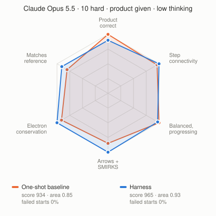
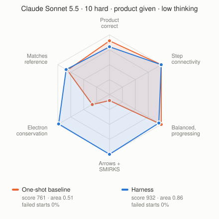
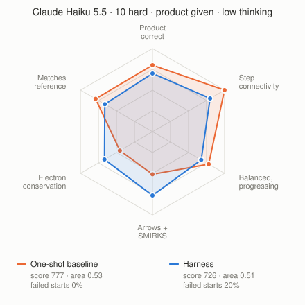
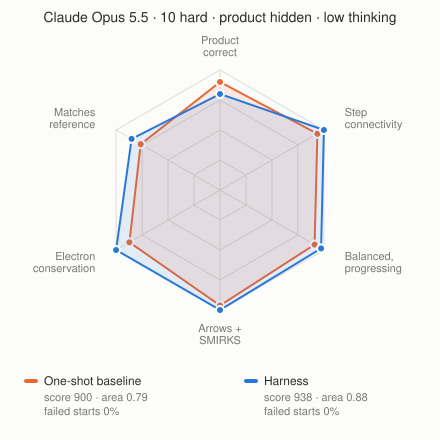
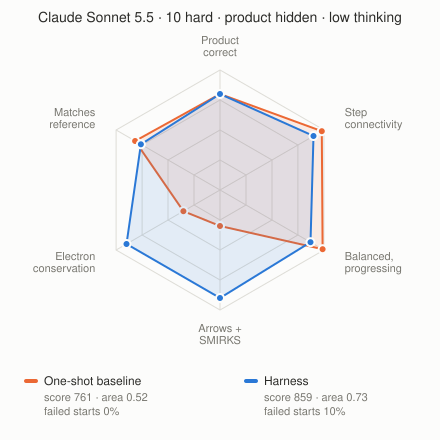
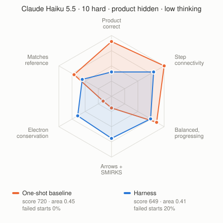
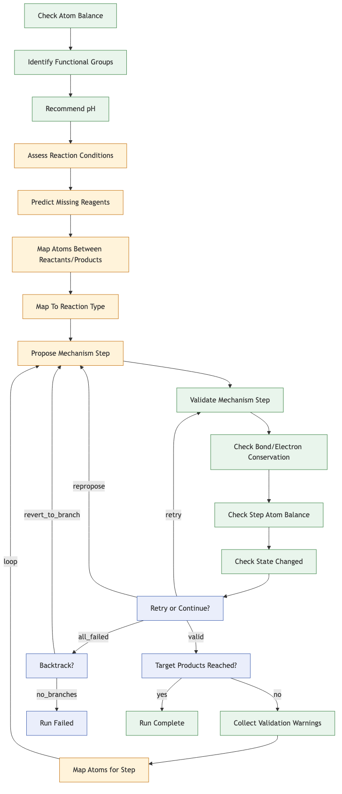

# Professor Wiggum — Mechanistic Agent


A local-first agent that predicts **arrow-pushing (elementary-step) mechanisms** for organic reactions. An LLM proposes each step; deterministic RDKit validators (bond/electron conservation, atom balance, state progress) decide whether the step is accepted. The harness — prompts, few-shots, module graph, validators — evolves only on eval evidence. See [SOUL.md](SOUL.md) for the philosophy.

## Leaderboard

We are focusing on one top-tier model — currently **Claude Opus 5.5** — to improve the harness, and will back-fill cheaper models later. Every run is scored with the same 1000-point [`quality_v2` rubric](docs/scoring_quality_v2.md) on 10-case slices of FlowER-derived tiers (easy = 1–2 steps, medium = 3, hard = 4–10). The rubric re-checks every step with the same deterministic code whether a harness or a one-shot answer produced it. It scores six axes: product, step connectivity, balance, arrows + SMIRKS, electron conservation and match to the reference. Connectivity means each step starts where the last one ended, so a mechanism that reaches the product through disconnected steps scores lower. There are no speed points. Links: [Claude Opus 5.5 by tier](LEADERBOARD.md#best-model-by-tier) · [harness vs one-shot baseline](LEADERBOARD.md#harness-vs-baseline).

### Does the harness help? Harness vs one-shot, same model

The question that matters most is whether the model can work out the **product** as well as the mechanism. In the **hidden** rows, the model is given only the starting materials and conditions, so it has to predict the product itself. The **given** rows hand it the product, which is the classic FlowER task. A one-shot answer usually names a plausible product. Its steps, though, often lack the atom-mapped SMIRKS and arrows that show how electrons move, or they do not conserve electrons. The harness validates every step before accepting it. For Opus 5.5 and Sonnet 5.5 the harness scores higher in both modes: by 31 and 38 points for Opus, and by 171 and 98 for Sonnet. Haiku 5.5 scores lower with the harness, by 51 and 71 points. In 2 of its 10 cases per mode it stopped before making a step (a *failed start*), and in other cases it paused partway.

<!-- harness-vs-baseline:start -->
| Cases | Product | Thinking | Model | Radar | One-shot baseline | Harness | Score Δ |
|---|---|---|---|---|---|---|---|
| 10 hard (trial_quality_v1_hard10) | given | low | **Claude Opus 5.5** † |  | **934**<br>area 0.85<br>failed starts 0%<br>product 10/10, pass 6/10 | **965**<br>area 0.93<br>failed starts 0%<br>product 9/10, pass 7/10 | +31 |
| 10 hard (trial_quality_v1_hard10) | given | low | **Claude Sonnet 5.5** † |  | **761**<br>area 0.51<br>failed starts 0%<br>product 9/10, pass 1/10 | **932**<br>area 0.86<br>failed starts 0%<br>product 8/10, pass 5/10 | +171 |
| 10 hard (trial_quality_v1_hard10) | given | low | **Claude Haiku 5.5** † |  | **777**<br>area 0.53<br>failed starts 0%<br>product 8/10, pass 1/10 | **726**<br>area 0.51<br>failed starts 20%<br>product 7/10, pass 3/10 | -51 |
| 10 hard (trial_quality_v1_hard10) | hidden | low | **Claude Opus 5.5** † |  | **900**<br>area 0.79<br>failed starts 0%<br>product 9/10, pass 2/10 | **938**<br>area 0.88<br>failed starts 0%<br>product 8/10, pass 4/10 | +38 |
| 10 hard (trial_quality_v1_hard10) | hidden | low | **Claude Sonnet 5.5** † |  | **761**<br>area 0.52<br>failed starts 0%<br>product 8/10, pass 1/10 | **859**<br>area 0.73<br>failed starts 10%<br>product 8/10, pass 4/10 | +98 |
| 10 hard (trial_quality_v1_hard10) | hidden | low | **Claude Haiku 5.5** † |  | **720**<br>area 0.45<br>failed starts 0%<br>product 9/10, pass 0/10 | **649**<br>area 0.41<br>failed starts 20%<br>product 4/10, pass 2/10 | -71 |

Same cases, same model, same thinking level. Radar: one-shot baseline orange, harness blue, on the six `quality_v2` axes. **Score** is on 1000 (0.2 product + 0.3 step connectivity + 0.5 mean step quality); **area** is the radar polygon area (1 = perfect); **failed starts** is the share of cases where the mechanism made no step. With the product **hidden** the model also had to predict it.
<!-- harness-vs-baseline:end -->

<!-- leaderboard:start -->
| Tier | Best model | Thinking | Quality | Valid steps | Passed | Harness | Date | Details |
|---|---|---|---|---|---|---|---|---|
| easy | **Claude Opus 5.5** † | default | **983**/1000 | 86% | 8/10 | `jev_reaction_type` | 2026-09-30 | [results](LEADERBOARD.md#2026-09-30-bridge-opus55-jev-deferred-easy-final3) |
| medium | **Claude Opus 5.5** † | default | **1000**/1000 | 100% | 10/10 | `jev_reaction_type` | 2026-09-30 | [results](LEADERBOARD.md#2026-09-30-bridge-opus55-jev-deferred-medium-final2-resumed) |
| hard | **Claude Opus 5.5** † | default | **972**/1000 | 96% | 8/10 | `jev_reaction_type` | 2026-09-29 | [results](LEADERBOARD.md#2026-09-29-bridge-opus55-jev-hard) |

Hardest mechanism solved so far: [`flower_020948`, a 9-step mechanism (hard tier, Claude Opus 5.5)](results/mechanisms/trial_q5_harness_low_given_resumed__flower_020948.png). Scored with the `quality_v2` rubric; harness vs baseline and legacy scores: [LEADERBOARD.md](LEADERBOARD.md).

† Answered through the [agent bridge](docs/agent_bridge.md): each model call went to the declared model in a fresh session that saw only the prompt (`responder_saw_ground_truth: false`). Cost is opaque, so these rows make no cost claim.
<!-- leaderboard:end -->

## Run types

All results land in the local SQLite database (`../wiggum-data/data/mechanistic.db` when the sibling data checkout exists; see [docs/DATA_SETUP.md](docs/DATA_SETUP.md)). Nothing reaches git until you publish it with `publish-results`.

| Run type | Invoke | Leaderboard |
|---|---|---|
| Single reaction | `python main.py run --starting "CCO" --products "CC=O"` (add `--mode verified` to submit your own steps) | none |
| Web UI | `python main.py serve` → `http://127.0.0.1:8010/` (unverified mode only; `/?run=<id>` replays a run) | none |
| Harness dev eval | `python main.py eval --tier easy\|medium\|hard --model <id> [--harness <name>]` or `--all-tiers` | [Opus 5.5 by tier](LEADERBOARD.md#best-model-by-tier) (published runs); local: `python main.py leaderboard --eval-set-id <id>`, UI, `GET /api/evals/leaderboard` |
| Harness-free baseline | `python main.py baseline --tier <tier> --model <id>` (or `--all-tiers`) | [Harness vs baseline](LEADERBOARD.md#harness-vs-baseline); local: development leaderboard, type `Baseline` |
| No-product (predict the product) | add `--hide-products` to `eval` or `baseline`; compare both at the same `--thinking-level` | same boards; rows marked "no product", Product and Mechanism columns |
| Official holdout | `python main.py eval-runset-official --model-name <id>` and `baseline-runset-official` | official leaderboard: `python main.py leaderboard-official`; holdout baselines are on the [baseline board](LEADERBOARD.md#harness-free-baselines) |
| Publish results | `python main.py publish-results --eval-run-id <id> [--open-pr]`, or `eval ... --publish [--open-pr]` | public [LEADERBOARD.md](LEADERBOARD.md) and the board above, from committed `results/runs/*.json` |
| Curriculum checkpoints | `python main.py curriculum submit\|publish\|render-readme --model-name <id>` | `curriculum/generated/leaderboard_*.json`, [curriculum/STATUS.md](curriculum/STATUS.md) |
| Harness evolution | `python scripts/evolve_harness.py`, `python main.py overnight-ralph`, `python main.py vote` | mined few-shot lanes and the Ralph experiment ledger (holdout sets are rejected) |

Notes:
- `eval --tier` goes through the development-leaderboard planner, which may re-route a run (for example to repeat the current tier). Pass `--leaderboard-route next` to move up a tier or `custom` to keep your own selection; see [docs/development_leaderboard_routes.md](docs/development_leaderboard_routes.md).
- `publish-results` exports an eval run to `results/runs/` (scores, per-case table, the hardest mechanism solved as an image) and regenerates `LEADERBOARD.md` and the board above. `--open-pr` branches from `origin/main`, commits only those files, and opens a PR; it never merges. Ground-truth replays are refused, and holdout runs publish aggregates only.
- Keyless runs (any eval or baseline above with `--model agent-bridge`, answered by `python main.py bridge-serve --command "<responder>"` or by subagents; see [docs/agent_bridge.md](docs/agent_bridge.md)) are not a separate run type: every leaderboard lists them under the responder's declared model, marked †.
- Leaderboards drop eval runs whose responder declares it saw the ground truth.
- Custom eval sets without FlowER data: [docs/custom_eval_sets.md](docs/custom_eval_sets.md). Keyless runs: [docs/agent_bridge.md](docs/agent_bridge.md).

## Contributing

There are three ways to contribute (details in [CONTRIBUTING.md](CONTRIBUTING.md)):

1. **Report a chemistry problem** — open a *Chemistry failure* issue with the starting materials, products, and what went wrong. That alone is a complete contribution.
2. **Report a bug or idea** — open a *Bug report* or *Feature request* issue.
3. **Submit code** — PRs are welcome; the only check you need is `python -m pytest tests/fast/ -q`.

Changes to prompts, few-shots, models, validators, or harness behaviour are evidence-gated by the maintainers before merge ([docs/change_evidence_policy.md](docs/change_evidence_policy.md)); you do not need to run model evals yourself. If you work through an agent with no API key, you can still produce runs and traces via the [agent bridge](docs/agent_bridge.md) — declare the responder's origin and ground-truth exposure so the runs can be used as evidence. To share a result, run `python main.py publish-results --eval-run-id <id> --open-pr`. Maintainer playbooks: [docs/agent_playbooks.md](docs/agent_playbooks.md).

## Developer

### Quick start

```bash
python -m venv .venv && source .venv/bin/activate
pip install -r requirements.txt && pip install -e . --no-deps
python -m pytest tests/fast/ -q
python main.py serve
```

Full setup: [SETUP.md](SETUP.md). Data layout (sibling `wiggum-data` checkout or in-repo fallback): [docs/DATA_SETUP.md](docs/DATA_SETUP.md). Runtime architecture, endpoints, and conventions: [AGENTS.md](AGENTS.md).

### Harness workflow



- **Pre-loop** (runs once): check atom balance → identify functional groups → recommend pH → assess conditions → predict missing reagents → map atoms → map to reaction type. The primary `threaded_unified` harness makes the last four one LLM call, checked section by section; `jev_reaction_type` uses a Jev decision for the reaction type
- **Loop**: propose next mechanism step (LLM) → bond/electron, atom-balance, and state-progress validators → retry, backtrack, or continue → target products reached? In `threaded_unified` the proposals continue one chat, rewound to the last accepted step when a proposal is rejected. Atom balance is strict in `threaded_unified` and `jev_reaction_type` (`balance_mode: proton_deferred`). Only a residual of whole protons — an acid or base the state did not carry — may be flagged for the end-of-run audit. Spare copies of a reagent left out of the state are carried forward rather than rejected. The `default` harness still flags any balance-only failure (`deferred`).
- **Post-loop**: the mechanism audit nets out the chosen path — regenerated catalysts, conjugate acid/base pairs, proton bookkeeping, recorded reagent additions — resolves each balance flag or fails the case, and reports redundant steps (undo steps, repeated states, mergeable proton transfers)

Harness variants live under `harness_versions/` (`threaded_unified`, the primary harness; `default`, `jev_reaction_type`, `permissive_default`, ablations). Regenerate the diagram with `python scripts/capture_harness_mermaid.py`.

### Docs

- Prompt/few-shot overrides: [docs/model_asset_overrides.md](docs/model_asset_overrides.md)
- History and reproducibility: [docs/history_and_reproducibility.md](docs/history_and_reproducibility.md)
- Evidence policy: [docs/change_evidence_policy.md](docs/change_evidence_policy.md)
- Curriculum lanes and checkpoints: [curriculum/STATUS.md](curriculum/STATUS.md)

The older Clawdiators-style 1000-point rubric (with product and speed points) is kept only for records published before the step-checked rubrics (`quality_v1`, now `quality_v2`); see **Legacy scores** in [LEADERBOARD.md](LEADERBOARD.md).
